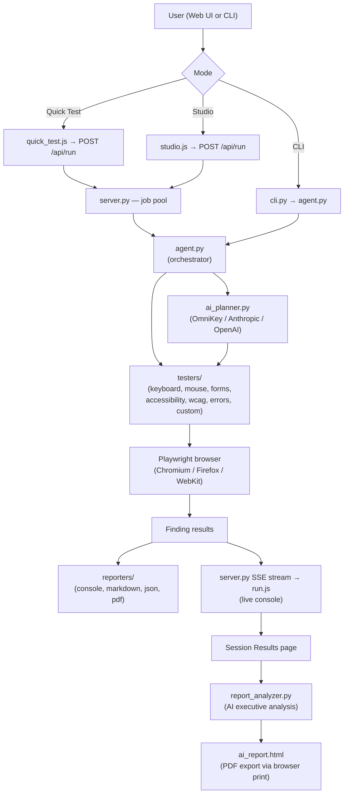

# 🔍 QA Agent

> **Automated exploratory testing powered by AI — with a beautiful Web UI and a full-featured CLI.**

[](https://pypi.org/project/qa-agent/)
[](LICENSE)

QA Agent is an autonomous web-testing platform that simulates real user interactions, audits for accessibility and WCAG compliance, detects console and network errors, and produces executive-quality AI reports — all without writing a single test script.

---

## 📋 Table of Contents

- [Features](#-features)
- [Quick Start](#-quick-start)
- [Web UI](#-web-ui)
  - [Non-Developer (Quick Test) Mode](#non-developer-quick-test-mode)
  - [Developer Studio Mode](#developer-studio-mode)
  - [Live Execution Console](#live-execution-console)
  - [Session Results](#session-results)
  - [AI Analysis & PDF Export](#ai-analysis--pdf-export)
- [CLI Usage](#-cli-usage)
- [Architecture](#-architecture)
- [AI Integration](#-ai-integration)
- [Environment Variables](#-environment-variables)
- [Test Suites](#-test-suites)
- [Output Formats](#-output-formats)
- [Extending QA Agent](#-extending-qa-agent)
- [CI/CD Integration](#-cicd-integration)
- [Troubleshooting](#-troubleshooting)
- [License](#-license)

---

## ✨ Features

| Capability | Details |
|---|---|
| **Web UI** | Beautiful browser-based interface — no CLI knowledge needed |
| **Quick Test Wizard** | Plain-English test instructions for non-developers |
| **Developer Studio** | Full multi-step configuration form with every option exposed |
| **Live Execution Console** | Real-time streaming log with test steps, findings, and progress |
| **AI-Powered Planning** | OmniKey (primary), Anthropic Claude, or OpenAI GPT-4o generate custom test steps |
| **AI Executive Report** | Post-run analysis: summary, prioritized remediation plan, root-cause clusters |
| **PDF Export** | One-click browser-native PDF of the AI report (no additional installs needed) |
| **Session History** | Browse, filter, and revisit every past test run |
| **7 Test Suites** | Keyboard, Mouse, Forms, Accessibility, WCAG, Console/Network Errors, Custom AI |
| **Headless & headed** | Run silently in CI or watch tests execute in a real browser |
| **CLI** | Full-featured command-line interface for automation and scripting |

---

## 🚀 Quick Start

### 1 — Install

```bash
# Core install (CLI + Web UI)
pip install -e .

# Install Playwright browser
playwright install chromium
```

### 2 — Set your AI key

```bash
# Windows PowerShell
$env:OMNIKEY_API_KEY = "omnikey-g-..."

# macOS / Linux
export OMNIKEY_API_KEY="omnikey-g-..."
```

### 3 — Run

**Web UI (recommended)**
```bash
python -m qa_agent.web.server
# Open http://localhost:5000
```

**CLI**
```bash
python -m qa_agent https://example.com
```

---

## 🌐 Web UI

Launch the web server and open `http://localhost:5000` in your browser.

```bash
python -m qa_agent.web.server
```

The UI has four main sections accessible from the top navigation:

| Page | Purpose |
|---|---|
| **Quick test** | Non-developer wizard — describe what to test in plain English |
| **Studio** | Full developer configuration form |
| **Sessions** | Browse all past test runs |
| *(Run page)* | Live execution console — shown automatically when a test starts |

---

### Non-Developer (Quick Test) Mode

The **Quick Test** page (`/quick-test`) provides a simplified wizard for users who aren't comfortable with CLI commands or configuration files.

1. Enter the URL(s) to test
2. Optionally describe what you want to test in plain English (e.g. *"Check that the login form works and checkout doesn't break"*)
3. Click **Run Test**

QA Agent uses the OmniKey AI provider to translate your instructions into concrete Playwright interactions automatically.

---

### Developer Studio Mode

The **Studio** page (`/studio`) exposes the full configuration across 6 wizard steps:

| Step | Settings |
|---|---|
| **Basic Config** | URLs to test, test mode (Focused / Explore), output formats, output directory |
| **Test Categories** | Enable/disable individual test suites |
| **Browser Settings** | Target browsers, viewport, timeout, parallel workers, screenshots, video recording, headless mode |
| **Authentication** | Login URL, username/password credentials, cookie injection |
| **Advanced Settings** | AI instructions (plain English), LLM provider selection, model, ignore URL patterns, plan caching |
| **Review & Run** | Summary of all settings before launching |

**Test Modes:**

- **Focused** — Tests only the URLs you specify
- **Explore** — Crawls links from the starting URL(s) up to a configurable depth and page count

---

### Live Execution Console

Once a test starts, the **Run page** (`/run/<job_id>`) shows a full-width live terminal that streams:

- 🟠 Current test step being executed (keyboard / mouse / forms / etc.)
- 🔴 Findings as they are discovered (with severity badges)
- 📸 Screenshot captures (noted in the log)
- 📊 Progress percentage and live metrics (pages tested, findings count, elapsed time)
- ✅ Completion — automatically navigates to the Session Results page

A **Stop Test** button is available to cancel at any time.

---

### Session Results

After a test completes, the **Session page** (`/session/<domain>/<session_id>`) shows:

- Summary stats: pages tested, issues found, passed tests, suggestions
- Full findings table with severity, category, description, and URL
- Screenshots gallery
- **AI Summary** — auto-generated executive paragraph
- **Download PDF** button → opens the dedicated AI report
- **AI Analysis** — trigger on-demand deep analysis with prioritized remediation

**Sessions List** (`/sessions`) — browse all past runs:

- Grouped by domain
- Each session shown as an individual card with date, duration, and finding counts
- Filter bar to search by domain or URL
- **+ New Test** button (top-right) to start a fresh run

---

### AI Analysis & PDF Export

Clicking **Download PDF** on a session page:

1. If an AI analysis hasn't been generated yet → triggers the analysis automatically (with a spinner)
2. Opens the dedicated AI Report page (`/session/<domain>/<session_id>/ai-report`)
3. Triggers the browser's native **Print → Save as PDF** dialog

The AI Report contains **only**:

- 📄 Executive Summary
- 🗂️ Prioritized Remediation Plan
- 🔗 Root-Cause Clusters
- 🌐 Cross-Browser Analysis

> **Note:** This uses the browser's built-in PDF export — no WeasyPrint or system dependencies required.

---

## 💻 CLI Usage

```bash
python -m qa_agent [OPTIONS] URL [URL...]
```

### Common Examples

```bash
# Basic test
python -m qa_agent https://example.com

# Explore mode — crawl up to 10 pages
python -m qa_agent --mode explore --max-pages 10 https://example.com

# With AI instructions (plain English)
python -m qa_agent --instructions "Verify the search bar returns results and the cart works" https://example.com

# Multiple output formats
python -m qa_agent --output console,json,markdown https://example.com

# With screenshots
python -m qa_agent --screenshots https://example.com

# Headless off (watch the browser)
python -m qa_agent --no-headless https://example.com

# Authenticated session
python -m qa_agent --auth-url https://example.com/login --username user@example.com --password secret https://example.com/dashboard
```

### Full CLI Reference

| Flag | Default | Description |
|---|---|---|
| `--mode` | `focused` | `focused` (test given URLs) or `explore` (crawl links) |
| `--max-pages` | `100` | Max pages to test in explore mode |
| `--max-depth` | `3` | Link crawl depth |
| `--output` | `console,markdown` | Output formats: `console`, `markdown`, `json`, `pdf` |
| `--output-dir` | `./qa-agent-output` | Directory for report files |
| `--screenshots` | off | Enable screenshot capture |
| `--screenshot-on-error` | on | Capture screenshot on finding |
| `--record-video` | off | Record WebM video of test execution |
| `--headless` / `--no-headless` | headless | Run browser in background or visible |
| `--viewport` | `1280x720` | Browser viewport (`WxH`) |
| `--timeout` | `30000` | Page timeout in milliseconds |
| `--workers` | `1` | Parallel page workers |
| `--instructions` | — | Plain-English AI test instructions |
| `--llm-provider` | `omnikey` | AI provider: `omnikey`, `anthropic`, `openai` |
| `--model` | provider default | Override model name |
| `--auth-url` | — | Login page URL |
| `--username` | — | Login username |
| `--password` | — | Login password |
| `--ignore` | — | URL patterns to skip (regex/glob, repeatable) |
| `--no-cache` | off | Disable AI test plan caching |
| `--test-keyboard` / `--no-test-keyboard` | on | Enable/disable keyboard navigation tests |
| `--test-mouse` / `--no-test-mouse` | on | Enable/disable mouse interaction tests |
| `--test-forms` / `--no-test-forms` | on | Enable/disable form tests |
| `--test-accessibility` / `--no-test-accessibility` | on | Enable/disable accessibility tests |
| `--test-wcag` / `--no-test-wcag` | on | Enable/disable WCAG compliance tests |
| `--test-errors` / `--no-test-errors` | on | Enable/disable console/network error tests |

---

## 🏗️ Architecture

### Directory Structure

```
qa_agent/
├── __init__.py              # Package init, version (0.3.0)
├── __main__.py              # Module entry point: python -m qa_agent
├── cli.py                   # Full CLI argument parsing (argparse)
├── agent.py                 # Core QA orchestrator — runs all test suites, manages pages
├── ai_planner.py            # LLM-powered test plan generation
├── config.py                # TestConfig, ScreenshotConfig, RecordingConfig, AuthConfig
├── llm_client.py            # OmniKeyClient, AnthropicClient, OpenAIClient (stdlib urllib)
├── models.py                # Finding, PageAnalysis, TestSession, SummaryResult, TestPlan
├── plan_cache.py            # Filesystem cache for AI test plans (avoid redundant API calls)
├── env_loader.py            # Loads .env file automatically on startup
├── report_analyzer.py       # Post-run AI analysis → executive reports
├── testers/
│   ├── base.py              # BaseTester + _take_screenshot (emits [SCREENSHOT] for SSE)
│   ├── keyboard.py          # TAB nav, arrow keys, Enter, Escape, focus traps
│   ├── mouse.py             # Click targets, hover, double-click, right-click, 44px WCAG
│   ├── forms.py             # Required fields, validation, labels, HTML5 types, autocomplete
│   ├── accessibility.py     # Alt text, headings, links, contrast, ARIA, landmarks, skip nav
│   ├── wcag_compliance.py   # Extended WCAG 2.1 AA checks
│   ├── custom.py            # AI-generated custom step executor
│   └── errors.py            # Console errors, network 4xx/5xx, JS exceptions, broken images
├── reporters/
│   ├── base.py              # BaseReporter interface
│   ├── console.py           # Real-time colored terminal output
│   ├── markdown.py          # Full Markdown report with tables and screenshots
│   ├── json_reporter.py     # Machine-readable JSON for CI/CD
│   └── pdf.py               # WeasyPrint PDF (optional; falls back gracefully on Windows)
└── web/
    ├── server.py            # Flask app — SSE streaming, job pool, session management, AI routes
    ├── static/
    │   ├── app.js           # Global nav and routing
    │   ├── index.js         # Landing page interactions
    │   ├── quick_test.js    # Non-developer wizard (sends llm_provider: omnikey)
    │   ├── studio.js        # Developer multi-step form (sends llm_provider: omnikey)
    │   ├── run.js           # Live console: SSE events → log/progress/finding/screenshot/complete
    │   ├── sessions.js      # Session list — individual domain-grouped cards
    │   ├── session.js       # Session detail, AI analysis trigger, Download PDF flow
    │   ├── style.css        # Full design system (warm beige/orange, spacious layout)
    │   └── hero-preview.png # Landing page QA illustration
    └── templates/
        ├── base.html        # Base layout with top nav
        ├── index.html       # Landing page with hero illustration
        ├── quick_test.html  # Non-developer wizard
        ├── studio.html      # Developer multi-step form
        ├── run.html         # Full-width live execution console
        ├── sessions.html    # Session cards list with filter + New Test button
        ├── session.html     # Session detail: findings, screenshots, AI summary
        └── ai_report.html   # A4-ready AI executive report (PDF export target)
```

### Data Flow



---

## 🤖 AI Integration

QA Agent supports three LLM providers. **OmniKey is the primary default.**

### Providers

| Provider | Env Var | Default Model | Notes |
|---|---|---|---|
| **OmniKey** *(primary)* | `OMNIKEY_API_KEY` | `google/gemma-4-26b-it` | Default for all Web UI and CLI tests |
| Anthropic Claude | `ANTHROPIC_API_KEY` | `claude-sonnet-4-6` | Auto-fallback to OmniKey if key absent |
| OpenAI | `OPENAI_API_KEY` | `gpt-4o` | Optional |

### Auto-Fallback

If Anthropic is selected as the provider but `ANTHROPIC_API_KEY` is not set, and `OMNIKEY_API_KEY` **is** set, QA Agent silently switches to OmniKey. No error is shown to the user.

This applies in:
- `agent.py → _generate_test_plan()`
- `server.py → api_analyze_session()`
- `server.py → session_ai_report_view()`

### What AI Does

1. **Test Plan Generation** — translates plain-English instructions into Playwright interaction steps (click, fill, assert, navigate)
2. **Custom Step Execution** — `testers/custom.py` runs AI-generated steps on each page
3. **Post-Run Analysis** — `report_analyzer.py` sends findings to the LLM and receives:
   - Executive summary paragraph
   - Prioritized remediation plan (ordered by impact)
   - Root-cause clusters (groups related issues)
   - Cross-browser analysis

### Plan Caching

AI test plans are cached on disk (`plan_cache.py`) so repeated runs on unchanged pages skip the API call. Disable with `--no-cache`.

---

## 🔐 Environment Variables

Create a `.env` file in the project root (loaded automatically):

```dotenv
# Primary AI provider (required for AI features)
OMNIKEY_API_KEY=omnikey-g-your-key-here
OMNIKEY_BASE_URL=https://api.omnikey.ai/v1
OMNIKEY_MODEL=google/gemma-4-26b-it
OMNIKEY_TIMEOUT_SECONDS=60

# Optional: Anthropic Claude (auto-fallback to OmniKey if absent)
ANTHROPIC_API_KEY=sk-ant-...

# Optional: OpenAI
OPENAI_API_KEY=sk-...
```

| Variable | Required | Description |
|---|---|---|
| `OMNIKEY_API_KEY` | For AI features | OmniKey API key |
| `OMNIKEY_BASE_URL` | No | Override OmniKey base URL |
| `OMNIKEY_MODEL` | No | Override OmniKey model |
| `OMNIKEY_TIMEOUT_SECONDS` | No | API request timeout (default: 60) |
| `ANTHROPIC_API_KEY` | No | Anthropic Claude key (optional; OmniKey used if absent) |
| `OPENAI_API_KEY` | No | OpenAI key |

> **Tip:** QA Agent works without any API key for standard (non-AI) test suites. AI keys are only needed for `--instructions`, AI analysis, and the Quick Test mode.

---

## 🧪 Test Suites

### Keyboard Navigation (`testers/keyboard.py`)

| Check | WCAG Criterion |
|---|---|
| TAB key reachability for all interactive elements | 2.1.1 |
| Arrow key navigation inside widgets (menus, tabs) | 2.1.1 |
| Enter key activates buttons and links | 2.1.1 |
| Escape key closes modals and dropdowns | 2.1.1 |
| Keyboard trap detection | 2.1.2 |
| Focus indicator visibility | 2.4.7 |

### Mouse Interactions (`testers/mouse.py`)

| Check | Details |
|---|---|
| Click target functionality | All buttons, links, and controls respond to clicks |
| Hover state feedback | Visual feedback on hover |
| Double-click behavior | Double-click actions work correctly |
| Right-click / context menus | Context menu behavior |
| Click target size | WCAG 2.5.5 — minimum 44×44 px |
| Overlapping elements | No unintended click interception |

### Form Handling (`testers/forms.py`)

| Check | Details |
|---|---|
| Required field indicators | Visual and ARIA markers for required fields |
| Input validation feedback | Error messages appear on invalid submission |
| Error message accessibility | Errors linked to inputs via `aria-describedby` |
| Form label associations | All inputs have associated `<label>` elements |
| HTML5 input types | `email`, `tel`, `number`, etc. used appropriately |
| Autocomplete attributes | `autocomplete` set on personal data fields |

### Accessibility (`testers/accessibility.py`)

| Check | WCAG Criterion |
|---|---|
| Image alt text | 1.1.1 |
| Heading structure (h1–h6) | 1.3.1 |
| Link text quality (no "click here") | 2.4.4 |
| Color contrast ratio | 1.4.3 (AA: 4.5:1 normal, 3:1 large) |
| ARIA role and attribute correctness | 4.1.2 |
| Landmark regions (`main`, `nav`, `header`, `footer`) | 1.3.1 |
| Page language attribute | 3.1.1 |
| Skip navigation links | 2.4.1 |

### WCAG Compliance (`testers/wcag_compliance.py`)

Extended WCAG 2.1 Level AA checks beyond the base accessibility suite.

### Console & Network Errors (`testers/errors.py`)

| Check | Details |
|---|---|
| JavaScript console errors | Any `console.error()` calls |
| Network errors | HTTP 4xx and 5xx responses |
| JavaScript exceptions | Uncaught errors and promise rejections |
| Broken images | `` tags that fail to load |
| Broken anchor links | Internal links that return 404 |
| Mixed content | HTTP resources on HTTPS pages |

### Custom AI Tests (`testers/custom.py`)

When `--instructions` is provided or instructions are entered in the Web UI, the AI planner generates custom Playwright steps. Examples:

- *"Verify the search bar returns at least 5 results for 'laptop'"*
- *"Add a product to cart and confirm the cart counter increments"*
- *"Submit the contact form and verify the success message appears"*

---

## 📄 Output Formats

| Format | Flag | File | Description |
|---|---|---|---|
| **Console** | `console` | — | Real-time colored output to stdout |
| **Markdown** | `markdown` | `report.md` | Full report with tables, findings, and screenshots |
| **JSON** | `json` | `report.json` | Machine-readable; ideal for CI/CD parsing |
| **PDF** | `pdf` | — | WeasyPrint PDF (optional; see note below) |

> **Windows note:** `weasyprint` requires GTK libraries that are complex to install on Windows. For PDF output from the Web UI, use the **Download PDF** button which uses the browser's native print dialog instead.

### Install WeasyPrint (Linux/macOS)

```bash
pip install -e ".[pdf]"
```

---

## 🛠️ Extending QA Agent

### Adding a New Test Suite

1. Create `qa_agent/testers/my_tester.py` extending `BaseTester`:

```python
from .base import BaseTester
from ..models import Finding, Severity

class MyTester(BaseTester):
    async def run(self) -> list[Finding]:
        findings = []
        # Use self.page (Playwright page object)
        # Use self._finding() to create Finding objects
        # Use await self._take_screenshot() to capture
        return findings
```

2. Register in `qa_agent/testers/__init__.py`
3. Add a config flag in `qa_agent/config.py` (e.g., `test_my_feature: bool = True`)
4. Call from `qa_agent/agent.py` inside `_test_page()`

### Finding Severity Levels

| Level | When to Use |
|---|---|
| `CRITICAL` | Security vulnerabilities, data loss risk |
| `HIGH` | Major usability blockers, broken core flows |
| `MEDIUM` | Accessibility failures, UX degradation |
| `LOW` | Minor improvements, best-practice gaps |
| `INFO` | Informational observations |

---

## ⚙️ CI/CD Integration

### Exit Codes

| Code | Meaning |
|---|---|
| `0` | All tests passed (or findings below threshold) |
| `1` | Findings found at or above the configured severity threshold |
| `2` | Runtime error (browser failed, invalid URL, etc.) |

### GitHub Actions Example

```yaml
- name: Run QA Agent
  env:
    OMNIKEY_API_KEY: ${{ secrets.OMNIKEY_API_KEY }}
  run: |
    pip install -e .
    playwright install chromium
    python -m qa_agent --output json,markdown --screenshots https://staging.example.com

- name: Upload QA Report
  uses: actions/upload-artifact@v4
  with:
    name: qa-report
    path: qa-agent-output/
```

### JSON Report Schema

```json
{
  "session_id": "abc12345",
  "url": "https://example.com",
  "started_at": "2026-10-29T03:00:00",
  "duration_seconds": 42.3,
  "pages_tested": 5,
  "findings": [
    {
      "severity": "MEDIUM",
      "category": "accessibility",
      "title": "Image missing alt text",
      "description": "...",
      "url": "https://example.com/about",
      "screenshot": "screenshots/001.png"
    }
  ]
}
```

---

## 🔧 Troubleshooting

### AI Analysis fails with "Anthropic API key not found"

QA Agent automatically falls back to OmniKey when `ANTHROPIC_API_KEY` is not set and `OMNIKEY_API_KEY` is available. If you see this error, ensure `OMNIKEY_API_KEY` is set in your environment or `.env` file.

### Web UI won't start

```bash
# Install web dependencies
pip install -e ".[web]"

# Start correctly (not qa-agent-web)
python -m qa_agent.web.server
```

### Playwright browser not found

```bash
playwright install chromium
# Or install all browsers:
playwright install
```

### Tests run but no AI analysis

AI analysis requires an API key. Set `OMNIKEY_API_KEY` in your environment:

```powershell
# PowerShell
$env:OMNIKEY_API_KEY = "omnikey-g-your-key-here"
```

```bash
# bash
export OMNIKEY_API_KEY="omnikey-g-your-key-here"
```

### PDF export doesn't work

The **Download PDF** button in the Web UI uses the browser's built-in **Print → Save as PDF**. No additional software is required. If the print dialog doesn't appear, check that your browser allows pop-ups from `localhost:5000`.

### Tests run very slowly

- Increase `--workers` for parallel page testing
- Use `--mode focused` to test only specific URLs instead of crawling
- Enable `--headless` (default) to skip rendering overhead
- Reduce `--max-interactions` per page

### `ruff` lint errors on contribution

```bash
pip install ruff
ruff check --fix qa_agent/
ruff format qa_agent/
```

---

## 📦 Installation Options

```bash
# Core (CLI only)
pip install -e .

# With Web UI
pip install -e ".[web]"

# With PDF support (WeasyPrint — Linux/macOS recommended)
pip install -e ".[pdf]"

# Everything
pip install -e ".[web,pdf]"

# Run tests
pytest tests/ --no-cov
```

---

## 📁 Session Storage

Sessions are stored locally in the output directory as JSON files:

```
qa-agent-output/
└── sessions/
    └── example.com/
        └── <session_id>/
            ├── session.json      # Full session data
            ├── report.md         # Markdown report
            ├── report.json       # JSON report
            └── screenshots/
                ├── 001.png
                └── 002.png
```

The Web UI reads these files at runtime — no database required.

---

## 📄 License

MIT — see [LICENSE](LICENSE) for details.

---

<p align="center">
  Built with ❤️ using <a href="https://playwright.dev/python/">Playwright</a> and <a href="https://flask.palletsprojects.com/">Flask</a>
</p>
