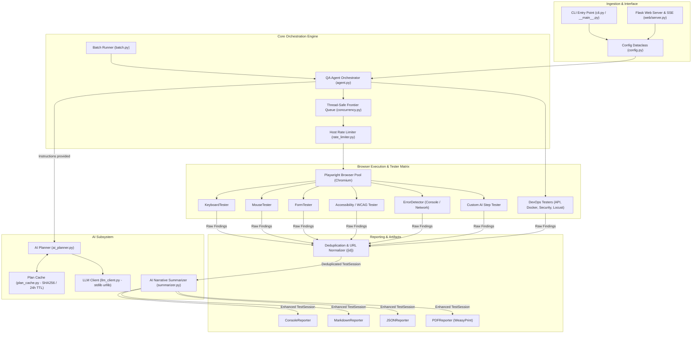
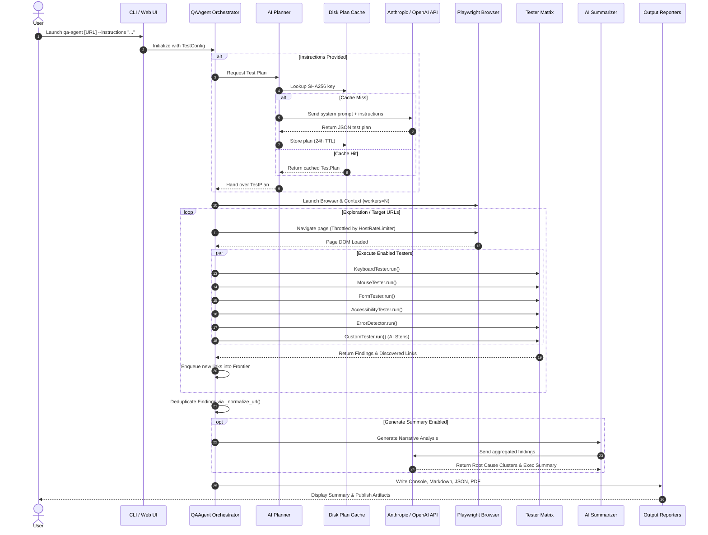

# QA Agent 🤖⚡

> **Autonomous, Agentic Exploratory QA & DevOps Testing for Modern Web Applications**  
> *Powered by Playwright and AI (Anthropic Claude / OpenAI GPT-4o)*

[](https://github.com/billrichards/qa-agent/actions/workflows/test.yml)
[](https://pypi.org/project/qa-agent/)
[](https://pypi.org/project/qa-agent/)
[](LICENSE)
[](pyproject.toml)

---

## 📌 Executive Overview

**QA Agent** is an end-to-end autonomous QA testing platform and CLI engine that simulates real human interaction, performs automated link crawling, executes comprehensive quality/accessibility audits, and generates actionable reports with zero manual test script maintenance.

When provided with plain-English instructions (e.g. bug reports, user stories, or feature specs), **QA Agent** leverages **LLM Agentic Planning** (via Anthropic Claude or OpenAI GPT-4o) to dynamically generate custom Playwright interaction steps and assertions on the fly.

Beyond standard UI testing, QA Agent includes a suite of **DevOps, API, Security, Container, and Performance testing engines** (Postman/Newman, OWASP ZAP, Docker security, Locust load testing), making it a complete software quality assurance agent for CI/CD pipelines.

<p align="center">
  
</p>

---

## 📖 Table of Contents

- [Core Capabilities](#-core-capabilities)
- [System Architecture](#-system-architecture)
  - [High-Level Architectural Diagram](#high-level-architectural-diagram)
  - [Module & Directory Map](#module--directory-map)
  - [Core Subsystems](#core-subsystems)
- [End-to-End Execution Workflow](#-end-to-end-execution-workflow)
  - [Sequence Workflow Diagram](#sequence-workflow-diagram)
  - [Detailed Execution Stages](#detailed-execution-stages)
- [Installation & Setup](#-installation--setup)
- [Quick Start](#-quick-start)
- [Usage Guide & CLI Flags](#-usage-guide--cli-flags)
  - [Testing Modes](#1-testing-modes)
  - [Agentic Natural-Language Testing](#2-agentic-natural-language-testing)
  - [Concurrency & Host Throttling](#3-concurrency--host-throttling)
  - [Batch Execution](#4-batch-execution)
  - [Authentication Setup](#5-authentication-setup)
- [Test Suite Catalog](#-test-suite-catalog)
  - [Core UI/UX Suites](#a-core-uiux-suites)
  - [DevOps & API Testing Suites](#b-devops--api-testing-suites)
  - [Security & Infrastructure Suites](#c-security--infrastructure-suites)
  - [Performance & Load Testing Suite](#d-performance--load-testing-suite)
- [Web Interface & REST API](#-web-interface--rest-api)
  - [Web Dashboard Features](#web-dashboard-features)
  - [REST API Endpoints](#rest-api-endpoints)
- [Programmatic Python API](#-programmatic-python-api)
- [Deduplication & Narrative AI Summaries](#-deduplication--narrative-ai-summaries)
- [Extending QA Agent (Custom Testers)](#-extending-qa-agent-custom-testers)
- [CI/CD Pipeline Integration](#-cicd-pipeline-integration)
- [Exit Codes & Failure Thresholds](#-exit-codes--failure-thresholds)
- [Troubleshooting & FAQs](#-troubleshooting--faqs)
- [License & Contributing](#-license--contributing)

---

## 🌟 Core Capabilities

| Capability | Overview |
|---|---|
| 🤖 **Agentic AI Testing** | Pass natural language bug reports or requirements; AI plans & executes targeted Playwright steps |
| 🕸️ **Exploratory Crawling** | Autonomous single-page (`focused`) testing or full-site dynamic discovery (`explore` mode) |
| ♿ **Accessibility & WCAG** | Automatic ARIA, contrast, focus-state, keyboard trap checking + opt-in WCAG 2.1 AA compliance audit |
| ⚡ **Concurrent Worker Pool** | Parallel multi-browser worker pool with per-host token-bucket rate limiting |
| 🔌 **DevOps & API Verification** | Integrated REST API runner, Postman/Newman collection runner, static code quality, & security header audits |
| 🐳 **Docker & Web Security** | Container security scanner, Dockerfile validator, and OWASP ZAP web vulnerability integration |
| 🚀 **Locust Performance Testing** | Concurrent load simulation tracking p95 response latencies, error rates, and user scaling |
| 📊 **Multi-Format Reporting** | Colorized Console tables, detailed Markdown with screenshots, structured JSON, and PDF reports |
| 🖥️ **Web UI & Real-Time SSE** | Flask web interface with live streaming console logs (Server-Sent Events) and past session browser |

---

## 🏗 System Architecture

QA Agent follows a decoupled, modular architecture structured around an orchestration agent (`QAAgent`), an AI planning subsystem, a concurrent page crawling engine, and a pluggable matrix of test execution suites and reporters.

### High-Level Architectural Diagram



---

### Module & Directory Map

```
qa_agent/
├── __init__.py               # Package metadata and public exports
├── __main__.py               # Executable module entry point (python -m qa_agent)
├── cli.py                    # Argument parsing, CLI flag routing, batch handler
├── agent.py                  # Core QAAgent orchestrator class
├── config.py                 # Configuration dataclasses (TestConfig, AuthConfig, etc.)
├── models.py                 # Data models (Finding, PageAnalysis, TestSession, TestPlan)
├── llm_client.py             # Stdlib urllib HTTP client for Anthropic & OpenAI
├── ai_planner.py             # Prompt builder & structured JSON response parser
├── plan_cache.py             # Disk-backed JSON plan cache with SHA-256 keys & TTL
├── summarizer.py             # Post-run narrative analysis, root cause clustering engine
├── batch.py                  # Concurrent multi-config BatchRunner pool
├── concurrency.py            # Thread-safe Frontier queue & PageIndexer
├── rate_limiter.py           # Per-host token-bucket navigation rate limiter
├── playwright_utils.py       # Helper functions for Playwright page handling
├── testers/                  # Modular test suite implementations
│   ├── base.py               # BaseTester abstract class definition
│   ├── keyboard.py           # Keyboard navigation, focus indicators, skip links
│   ├── mouse.py              # Mouse interaction, hover effects, link validation
│   ├── forms.py              # Form detection, input fuzzing, HTML5 validation
│   ├── accessibility.py      # Core WCAG checks (ARIA, alt text, contrast)
│   ├── wcag_compliance.py    # Opt-in full WCAG 2.1 AA auditing engine
│   ├── errors.py             # Console error logger & network failure trap
│   ├── custom.py             # AI-generated custom step action/assertion executor
│   ├── api_tester.py         # REST API status & payload tester
│   ├── newman_tester.py      # Postman collection runner via Newman CLI
│   ├── code_quality.py       # Code linting & formatting checks
│   ├── security_checks.py    # Security header & SSL validation
│   ├── project_health.py     # Repository structure & dependency checks
│   ├── docker_tester.py      # Docker container configuration auditor
│   ├── container_security.py # Container security & vulnerability scanner
│   ├── zap_tester.py         # OWASP ZAP security scanner integration
│   └── performance_tester.py # Locust performance & load testing engine
├── reporters/                # Multi-format report generators
│   ├── base.py               # BaseReporter interface
│   ├── console.py            # Terminal reporter with rich tabular output
│   ├── markdown.py           # Markdown reporter with embedded screenshot links
│   ├── json_reporter.py      # Machine-readable JSON output generator
│   └── pdf.py                # WeasyPrint PDF report renderer
└── web/                      # Web interface & REST API
    ├── server.py             # Flask application server & SSE event streamer
    ├── static/               # CSS stylesheets & frontend JS scripts
    └── templates/            # Jinja2 HTML templates for web dashboard
```

---

### Core Subsystems

#### 1. AI Test Planner (`ai_planner.py` & `llm_client.py`)
- **Zero Heavy Dependencies**: Implemented using Python's standard library `urllib.request`, eliminating third-party SDK lock-in.
- **Provider Support**: Seamlessly switch between **Anthropic Claude** (`claude-sonnet-4-6`) and **OpenAI GPT** (`gpt-4o`).
- **Structured Output Generation**: Constructs strict system prompts enforcing JSON schemas containing test steps (actions: `click`, `fill`, `hover`, `press_key`, `wait`, `navigate`, `scroll`; assertions: `visible`, `hidden`, `text_contains`, `url_contains`, `element_count`). Includes robust fallback regex parsing for markdown-wrapped responses.
- **Plan Caching (`plan_cache.py`)**: Hashes the target URL and instructions into a SHA-256 digest. Caches responses locally in `~/.qa_agent/cache/` for 24 hours to prevent unnecessary API spending.

#### 2. Concurrency & Rate Limiting (`concurrency.py` & `rate_limiter.py`)
- **Frontier Queue**: Thread-safe URL discovery queue utilizing `threading.Lock` and atomic sets to manage multi-worker crawling without race conditions or duplicate page visits.
- **Host Rate Limiter**: Implements a token-bucket rate limiter (`HostRateLimiter`) capping `page.goto()` calls per hostname (default `3.0 req/sec`, max `50.0 req/sec`). Prevents accidental Denial-of-Service (DoS) on staging or dev servers during multi-worker runs.

#### 3. Deduplication & Root Cause Clustering (`models.py` & `summarizer.py`)
- **URL Normalization (`_normalize_url`)**: Applies regex patterns to replace dynamic path components (UUIDs, numeric IDs, slug strings) with a unified `{id}` placeholder.
- **Finding Consolidation**: Merges findings sharing identical `(title, category, severity, normalized_url)`. Stores all distinct occurrence URLs under `affected_urls`, eliminating report bloat.
- **Root Cause Analysis**: Optional post-run AI step synthesizes raw findings into executive summaries, priority recommendations, and root-cause clusters.

---

## 🔄 End-to-End Execution Workflow

### Sequence Workflow Diagram



---

### Detailed Execution Stages

1. **Initialization & Config Parsing**:
   - The CLI parser (`cli.py`) processes user arguments or batch specs, constructing a validated `TestConfig` dataclass instance.
   - Session directory paths are created under `output/<domain>/<session_id>/qa_reports|screenshots|recordings`.

2. **AI Test Plan Generation**:
   - If `--instructions` or `--instructions-file` is passed, `QAAgent` queries `AIPlanner`.
   - The planner checks the local filesystem cache (`plan_cache.py`). On cache miss, it calls Anthropic or OpenAI API via `LLMClient` to convert natural language into Playwright action/assertion chains.

3. **Browser Lifecycle Setup**:
   - Playwright launches a Chromium browser context in headless or headed mode.
   - Cookies, HTTP Bearer tokens, or custom headers are injected into the browser context.

4. **Frontier Navigation & Rate Limiting**:
   - In `focused` mode, the agent navigates only to specified URLs.
   - In `explore` mode, the agent discovers internal hyperlinks, checks them against `ignore_patterns` and `same_domain_only` rules, and feeds them into the thread-safe `Frontier`.
   - All `page.goto()` calls pass through `HostRateLimiter` to honor per-host throttling limits.

5. **Modular Tester Suite Execution**:
   - For every loaded page, enabled testers in `qa_agent/testers/` execute concurrently against the Playwright `Page` object.
   - Any runtime exceptions, HTTP 4xx/5xx network failures, ARIA violations, or unmet custom AI assertions are recorded as `Finding` objects with attached screenshot evidence.

6. **Deduplication & Aggregation**:
   - `TestSession.get_deduplicated_findings()` groups identical findings across dynamic route paths using URL normalization patterns.

7. **Reporting & Summary Generation**:
   - Active reporters consume the `TestSession` and produce console summary tables, Markdown reports, JSON data files, and PDF documents.

---

## 💻 Installation & Setup

### Prerequisites
- **Python**: Version `3.10` or higher required.
- **OS**: Windows, macOS, or Linux.

### Installation Options

```bash
# Standard installation (Playwright browser automation included)
pip install qa-agent

# Install optional feature extras
pip install "qa-agent[pdf]"     # Enables PDF report generation (WeasyPrint)
pip install "qa-agent[web]"     # Enables Web UI & REST API server (Flask)
pip install "qa-agent[all]"     # Installs all optional dependencies
```

### Install Playwright Browsers
Chromium is downloaded automatically on the first run. If manual installation is required:

```bash
playwright install chromium
```

### Environment Variable Setup
Agentic testing and post-run narrative summaries require an API key for Anthropic or OpenAI:

```bash
# For Anthropic Claude (Default Provider)
export ANTHROPIC_API_KEY="sk-ant-..."

# For OpenAI GPT-4o
export OPENAI_API_KEY="sk-..."

# Optional: Web UI server configuration
export QA_AGENT_JOB_POOL_SIZE=4
export QA_AGENT_RATE_LIMIT=3.0
```

---

## ⚡ Quick Start

```bash
# 1. Test a single web page (Console & Markdown report)
qa-agent https://example.com

# 2. Test multiple pages
qa-agent https://example.com https://example.com/about https://example.com/contact

# 3. Explore & crawl an entire application (up to 3 levels deep, max 25 pages)
qa-agent --mode explore --max-depth 3 --max-pages 25 https://example.com

# 4. Agentic AI testing from a bug description
qa-agent --instructions "Verify that clicking 'Forgot Password' sends a reset link." https://example.com/login

# 5. Launch the Web UI Dashboard
qa-agent-web --port 5000
```

---

## 🎛 Usage Guide & CLI Flags

### 1. Testing Modes

- **Focused Mode (`--mode focused`)** *(Default)*: Only tests the explicit URLs provided on the command line.
- **Explore Mode (`--mode explore`)**: Autonomous crawler that extracts internal hyperlinks, constructs a site map graph, and tests newly discovered pages up to `--max-depth` and `--max-pages`.

```bash
qa-agent --mode explore --max-depth 2 --max-pages 50 --allow-external https://example.com
```

### 2. Agentic Natural-Language Testing

Direct the QA Agent using natural language instructions. The AI planner generates custom Playwright steps that execute alongside standard test suites.

```bash
# From command-line instruction
qa-agent --instructions "Search for 'laptop', add the first item to cart, and proceed to checkout" https://shop.example.com

# From a specification file
qa-agent --instructions-file ./specs/checkout_flow.txt https://shop.example.com

# Override default provider & model
qa-agent --llm openai --ai-model gpt-4o-mini --instructions "Check navbar links" https://example.com

# Bypass 24-hour plan disk cache
qa-agent --no-cache --instructions "Test contact form" https://example.com
```

### 3. Concurrency & Host Throttling

Scale test execution using multiple worker threads. Each worker controls an isolated browser context.

```bash
# Run 4 parallel worker threads with a 5 req/sec host rate limit
qa-agent --workers 4 --rate-limit 5.0 --mode explore https://example.com
```

### 4. Batch Execution

Execute multiple independent testing sessions concurrently from a JSON specification file using `--batch-file`.

```bash
qa-agent --batch-file test_suite.json --pool-size 4
```

*Example `test_suite.json`:*
```json
[
  {
    "urls": ["https://example.com/app"],
    "mode": "explore",
    "workers": 4,
    "max_pages": 20
  },
  {
    "urls": ["https://example.com/login"],
    "instructions": "Verify error banner appears when submitting empty form"
  }
]
```

### 5. Authentication Setup

Authenticate before testing protected application routes:

```bash
# Inline login credentials (performs automated form submission)
qa-agent --auth "user:password@https://example.com/login" https://example.com/dashboard

# Form login via auth.json configuration file
qa-agent --auth-file auth.json https://example.com/dashboard

# Inject pre-existing session cookies
qa-agent --cookies cookies.json https://example.com/dashboard

# Inject custom HTTP headers (e.g. Bearer token)
qa-agent --header "Authorization: Bearer eyJhbGci..." https://example.com/api
```

*Example `auth.json`:*
```json
{
  "username": "test_admin",
  "password": "SecretPassword123!",
  "auth_url": "https://example.com/login",
  "username_selector": "#email-input",
  "password_selector": "#password-input",
  "submit_selector": "button[type='submit']"
}
```

---

## 🔬 Test Suite Catalog

QA Agent includes **15+ specialized testing engines**:

### A. Core UI/UX Suites

| Suite | Flag | Description |
|---|---|---|
| **Keyboard Navigation** | `--skip-keyboard` (default ON) | Validates tab order, focus visibility, keyboard traps, and skip-to-content links |
| **Mouse Interaction** | `--skip-mouse` (default ON) | Tests hover states, dynamic dropdowns, broken links, and target element reactivity |
| **Form Handling** | `--skip-forms` (default ON) | Fuzzes input fields, checks HTML5 validations, aria-labels, and password toggles |
| **Accessibility Audit** | `--skip-accessibility` (default ON) | Checks image `alt` tags, heading hierarchy (`h1`-`h6`), contrast ratios, and ARIA roles |
| **Error Detector** | `--skip-errors` (default ON) | Traps uncaught JS console errors, unhandled promise rejections, & HTTP 4xx/5xx network failures |
| **WCAG Compliance** | `--wcag-compliance` (opt-in) | In-depth audit enforcing WCAG 2.1 AA guidelines across color, structure, and text sizing |
| **Custom AI Tester** | Auto-enabled with `--instructions` | Executes AI-planned action/assertion sequences (clicks, fills, keypresses, visibility assertions) |

### B. DevOps & API Testing Suites

| Suite | Flag | Description |
|---|---|---|
| **REST API Tester** | `--enable-api-tests` | Verifies REST API status codes, response content-types, payload schemas, and latency |
| **Newman / Postman** | `--postman-collection FILE` | Executes complex Postman collections against target APIs via Newman integration |
| **Code Quality** | `--enable-code-quality` | Runs linting and static analysis checks on target codebase components |
| **Project Health** | `--enable-project-health` | Audits workspace repository structure, license files, and dependency lockfiles |

### C. Security & Infrastructure Suites

| Suite | Flag | Description |
|---|---|---|
| **Security Checks** | `--enable-security-checks` | Scans HTTP security headers (`HSTS`, `CSP`, `X-Frame-Options`), SSL/TLS configs, and cookies |
| **Docker Tester** | `--enable-docker-tests` | Validates Dockerfile best practices, user permissions, and container runtime settings |
| **Container Security**| `--enable-container-security` | Scans container images for vulnerabilities, root execution risks, and exposed secrets |
| **OWASP ZAP Tester** | `--enable-web-security` | Integrates with OWASP ZAP to run automated web vulnerability scans (XSS, SQLi, CSRF) |

### D. Performance & Load Testing Suite

| Suite | Flag | Description |
|---|---|---|
| **Locust Load Test** | `--enable-performance-tests` | Simulates user load via Locust, measuring p95 response time and error rate caps |

```bash
# Configure Locust Performance Benchmark
qa-agent --enable-performance-tests \
  --locust-users 20 \
  --locust-spawn-rate 5 \
  --locust-duration 10 \
  --max-p95-ms 2000 \
  --max-error-rate 2.0 \
  https://example.com
```

---

## 🌐 Web Interface & REST API

QA Agent includes a built-in Flask web application providing a graphical dashboard and a complete REST API.

```bash
# Launch the web interface (Default: http://127.0.0.1:5000)
python -m qa_agent web

# Bind to custom host and port
qa-agent-web --host 0.0.0.0 --port 8080
```

<p align="center">
  
</p>

### Web Dashboard Features
- **Graphical Form**: Launch test runs with custom URLs, mode selection, worker configuration, and agentic instructions.
- **Real-Time Log Stream**: View live execution output powered by Server-Sent Events (SSE).
- **Session Manager**: Inspect past testing runs grouped by domain.
- **Interactive Reports**: Browse detailed findings tables, inspect full-page error screenshots, and download PDF/JSON artifacts.

<p align="center">
  
</p>

---

### REST API Endpoints

| Endpoint | Method | Description |
|---|---|---|
| `/api/run` | `POST` | Trigger a new test run. Accepts JSON matching `TestConfig` schema. Returns `job_id`. |
| `/api/stream/<job_id>` | `GET` | SSE stream endpoint delivering real-time output text logs and status events. |
| `/api/sessions` | `GET` | List all historical test sessions with pagination (`?limit=10&offset=0`). |
| `/api/sessions/<session_id>` | `GET` | Retrieve full JSON details and findings for a specific test session. |
| `/api/stop/<job_id>` | `POST` | Gracefully cancel a currently executing test job. |

*Example `POST /api/run` payload:*
```json
{
  "urls": ["https://example.com"],
  "mode": "explore",
  "max_pages": 10,
  "workers": 2,
  "instructions": "Ensure user profile updates correctly."
}
```

---

## 🐍 Programmatic Python API

Embed `QA Agent` directly into existing Python test frameworks, backend servers, or automation scripts.

### Single Session Execution

```python
from qa_agent import QAAgent, TestConfig, TestMode, OutputFormat

# 1. Construct Configuration
config = TestConfig(
    urls=["https://example.com"],
    mode=TestMode.EXPLORE,
    output_formats=[OutputFormat.CONSOLE, OutputFormat.JSON, OutputFormat.MARKDOWN],
    max_depth=2,
    max_pages=15,
    workers=2,
    instructions="Check that all footer links navigate to valid pages.",
)

# 2. Initialize and Run Agent
agent = QAAgent(config)
session = agent.run()

# 3. Inspect Session Results
print(f"Session ID:      {session.session_id}")
print(f"Status:          {session.status}")
print(f"Pages Tested:    {len(session.pages_tested)}")
print(f"Total Findings:  {session.total_findings}")

# Iterate over findings
for finding in session.get_deduplicated_findings():
    print(f"[{finding.severity.value.upper()}] {finding.title} @ {finding.url}")
```

### Parallel Batch Execution

```python
from qa_agent import BatchRunner, TestConfig, TestMode

configs = [
    TestConfig(urls=["https://example.com/app1"], mode=TestMode.EXPLORE, workers=2),
    TestConfig(urls=["https://example.com/app2"], instructions="Verify login flow"),
]

# Run multiple test configurations concurrently across a pool of 4 workers
with BatchRunner(pool_size=4) as runner:
    results = runner.run_all(configs)
    for result in results:
        if isinstance(result, Exception):
            print(f"Test run failed: {result}")
        else:
            print(f"Session {result.session_id} finished with {result.total_findings} findings.")
```

---

## 🧠 Deduplication & Narrative AI Summaries

### URL Normalization & Deduplication Engine
When crawling dynamic applications (e.g. `/products/101`, `/products/102`), testing engines often discover the exact same issue across hundreds of parameterized pages.

QA Agent standardizes path segments using `_normalize_url`:
- UUIDs (`550e8400-e29b-41d4-a716-446655440000`) $\rightarrow$ `{id}`
- Numeric IDs (`/users/42/settings`) $\rightarrow$ `/users/{id}/settings`
- Slug patterns (`/items/123-blue-widget`) $\rightarrow$ `/items/{id}`

Findings sharing the same title, category, severity, and normalized URL are merged into a single `Finding` object, with all original URLs stored in `affected_urls`.

### Narrative AI Summary (`--summary`)
When `--summary` is enabled, QA Agent performs post-run LLM synthesis to produce:
1. **Executive Summary**: High-level narrative for engineering management.
2. **Root Cause Clusters**: Groups related symptoms across pages to their root cause (e.g., *Missing global CSS stylesheet causing nationwide contrast failures*).
3. **Priority Recommendations**: Ranked list of actionable fixes.
4. **False Positive Candidates**: Highlights potential low-confidence warnings.

---

## 🛠 Extending QA Agent (Custom Testers)

You can extend QA Agent by adding custom test suites.

### 1. Create your tester module
Create a new file in `qa_agent/testers/my_custom_tester.py` extending `BaseTester`:

```python
# qa_agent/testers/my_custom_tester.py
from playwright.sync_api import Page
from .base import BaseTester
from ..models import Finding, FindingCategory, Severity, FindingStatus

class MyCustomTester(BaseTester):
    """Custom tester verifying specific business logic rules."""

    def run(self) -> list[Finding]:
        findings: list[Finding] = []

        # Access Playwright page and TestConfig via self.page and self.config
        buttons = self.page.query_selector_all("button.action-btn")
        for btn in buttons:
            if not btn.get_attribute("aria-label"):
                findings.append(
                    Finding(
                        title="Action Button Missing Aria-Label",
                        description="Action buttons must have explicit aria-label attributes.",
                        category=FindingCategory.ACCESSIBILITY,
                        severity=Severity.MEDIUM,
                        url=self.page.url,
                        element_selector="button.action-btn",
                        recommendation="Add an aria-label attribute describing the action.",
                    )
                )
        return findings
```

### 2. Export in `qa_agent/testers/__init__.py`
```python
from .my_custom_tester import MyCustomTester

__all__ = [..., "MyCustomTester"]
```

### 3. Register in `TestConfig` & `QAAgent`
Add a configuration toggle in `config.py`:
```python
@dataclass
class TestConfig:
    # ...
    test_my_custom_rule: bool = True
```

In `qa_agent/agent.py`, invoke your tester inside page execution:
```python
if self.config.test_my_custom_rule:
    from .testers import MyCustomTester
    findings.extend(MyCustomTester(page, self.config).run())
```

---

## 🚀 CI/CD Pipeline Integration

### GitHub Actions Workflow

Create `.github/workflows/qa-agent.yml`:

```yaml
name: Automated QA Audit

on:
  push:
    branches: [ main, develop ]
  pull_request:
    branches: [ main ]
  schedule:
    - cron: '0 0 * * *' # Run daily at midnight

jobs:
  qa-audit:
    runs-on: ubuntu-latest

    steps:
      - name: Checkout Code
        uses: actions/checkout@v4

      - name: Set up Python 3.11
        uses: actions/setup-python@v5
        with:
          python-version: "3.11"
          cache: "pip"

      - name: Install Dependencies & QA Agent
        run: |
          python -m pip install --upgrade pip
          pip install "qa-agent[all]"
          playwright install --with-deps chromium

      - name: Execute QA Agent
        env:
          ANTHROPIC_API_KEY: ${{ secrets.ANTHROPIC_API_KEY }}
        run: |
          qa-agent --mode explore \
            --max-depth 2 \
            --max-pages 20 \
            --workers 4 \
            --output console,markdown,json \
            --screenshots \
            --fail-on-severity high \
            https://staging.example.com

      - name: Upload Test Reports & Screenshots
        if: always()
        uses: actions/upload-artifact@v4
        with:
          name: qa-agent-reports
          path: ./qa-agent-output/
```

---

## 🚦 Exit Codes & Failure Thresholds

QA Agent returns explicit process exit codes for automated build pipelines:

| Exit Code | Condition |
|---|---|
| `0` | All tests completed successfully with no findings exceeding failure threshold |
| `1` | One or more findings exceeded severity threshold (`CRITICAL` or `HIGH` by default) |
| `2` | Execution error (invalid configuration, unreachable initial target URL, browser failure) |
| `130` | Session interrupted manually via KeyboardInterrupt (`Ctrl+C`) |

### Customizing Failure Severity Thresholds
Use `--fail-on-severity` to control when CI builds fail:

```bash
# Fail CI build ONLY on CRITICAL findings
qa-agent --fail-on-severity critical https://example.com

# Fail CI build on MEDIUM, HIGH, or CRITICAL findings
qa-agent --fail-on-severity medium https://example.com
```

---

## 📋 Comprehensive CLI Argument Reference Table

| Flag | Category | Default | Description |
|---|---|---|---|
| `urls` | General | Positional | One or more target URLs to test |
| `--mode {focused,explore}` | Execution | `focused` | `focused`: test target URLs only; `explore`: crawl dynamic links |
| `--instructions TEXT` | Agentic AI | `None` | Natural language instructions for AI test step generation |
| `--instructions-file PATH`| Agentic AI | `None` | Path to text file containing natural language instructions |
| `--llm {anthropic,openai}`| Agentic AI | `anthropic` | LLM provider for AI instructions |
| `--ai-model MODEL` | Agentic AI | Provider Default | Model override (`claude-sonnet-4-6`, `gpt-4o`) |
| `--no-cache` | Agentic AI | `False` | Bypass 24-hour disk plan cache |
| `--summary` | Agentic AI | `False` | Generate LLM post-run narrative analysis & root cause summary |
| `--workers N` | Concurrency | `1` | Number of parallel browser page-workers (1-16) |
| `--rate-limit N` | Concurrency | `3.0` | Max page navigations/sec per host (`0` = unlimited) |
| `--batch-file PATH` | Batch | `None` | JSON file containing multiple run specifications |
| `--pool-size N` | Batch | `4` | Max concurrent sessions for batch runs (1-8) |
| `--max-depth N` | Exploration | `3` | Maximum link depth traversal in explore mode |
| `--max-pages N` | Exploration | `100` | Maximum pages to test in explore mode |
| `--max-interactions N` | Exploration | `50` | Maximum element interactions per page |
| `--allow-external` | Exploration | `False` | Allow crawler to follow links to external domains |
| `--ignore PATTERN` | Exploration | `[]` | Regex patterns for URLs to skip during crawling |
| `--auth SPEC` | Auth | `None` | Credentials spec: `user:pass@url` |
| `--auth-file PATH` | Auth | `None` | Path to JSON file containing auth configuration |
| `--cookies PATH` | Auth | `None` | Path to JSON cookies file |
| `--header HEADER` | Auth | `None` | Custom HTTP header (repeatable, e.g. `"Auth: Bearer x"`) |
| `--output FORMATS` | Output | `console,markdown` | Output formats comma-separated (`console,markdown,json,pdf`) |
| `--output-dir PATH` | Output | `./qa-agent-output` | Target directory for generated reports |
| `--screenshots` | Media | `False` (on error) | Capture screenshot evidence on test errors |
| `--screenshots-all` | Media | `False` | Capture screenshot evidence on every interaction |
| `--full-page` | Media | `False` | Capture full-page scrollable screenshots |
| `--record` | Media | `False` | Record WebM session video recordings |
| `--no-headless` | Browser | `False` | Launch visible browser window (headed mode) |
| `--viewport WxH` | Browser | `1280x720` | Browser viewport dimensions |
| `--timeout MS` | Browser | `30000` | Navigation & element action timeout in milliseconds |
| `--skip-keyboard` | Suites | `False` | Skip keyboard navigation test suite |
| `--skip-mouse` | Suites | `False` | Skip mouse interaction test suite |
| `--skip-forms` | Suites | `False` | Skip form handling test suite |
| `--skip-accessibility` | Suites | `False` | Skip accessibility test suite |
| `--skip-errors` | Suites | `False` | Skip console & network error trap suite |
| `--wcag-compliance` | Suites | `False` | Enable comprehensive WCAG 2.1 AA compliance audit |
| `--enable-api-tests` | DevOps | `False` | Enable REST API verification suite |
| `--postman-collection` | DevOps | `None` | Path to Postman collection JSON for Newman testing |
| `--enable-code-quality` | DevOps | `False` | Enable code quality linting suite |
| `--enable-security-checks`| DevOps | `False` | Enable security header & SSL audit suite |
| `--enable-docker-tests` | DevOps | `False` | Enable Docker container audit suite |
| `--enable-container-sec` | DevOps | `False` | Enable container security scanner suite |
| `--enable-web-security` | DevOps | `False` | Enable OWASP ZAP vulnerability scanner |
| `--enable-performance` | DevOps | `False` | Enable Locust performance load testing suite |
| `--fail-on-severity` | CI/CD | `high` | Severity threshold for exit code 1 (`critical,high,medium,low`) |

---

## ❓ Troubleshooting & FAQs

### 1. Playwright browser executable is missing
If Playwright raises an error stating `Executable doesn't exist`, run:
```bash
playwright install chromium
```
In Linux CI environments, install operating system dependencies:
```bash
playwright install-deps chromium
```

### 2. PDF generation fails or falls back to Markdown
PDF generation relies on `WeasyPrint`. Install the `pdf` extra:
```bash
pip install "qa-agent[pdf]"
```
*Note for GTK dependencies*: On Windows/macOS, WeasyPrint may require native GTK libraries. If absent, QA Agent falls back to Markdown reporting.

### 3. Agentic AI instructions warning
If QA Agent outputs `[WARNING] AI planning failed: API key missing`, ensure your environment variable is exported:
```bash
export ANTHROPIC_API_KEY="sk-ant-..."
# or
export OPENAI_API_KEY="sk-..."
```

### 4. High CPU/RAM utilization during parallel runs
Each worker thread spawns a distinct browser context. When running with high worker counts (`--workers 8` or higher), ensure your system has sufficient RAM (approx. 150MB-300MB RAM per worker). Adjust `--rate-limit` to prevent target server congestion.

---

## 📄 License & Contributing

Distributed under the **MIT License**. See [`LICENSE`](LICENSE) for complete licensing terms.

Contributions, issues, and feature requests are welcome! Check out [`CONTRIBUTING.md`](CONTRIBUTING.md) for development environment setup and guidelines.

---

<p align="center">
  <b>Built with ❤️ for modern software development & QA engineering teams.</b>
</p>
